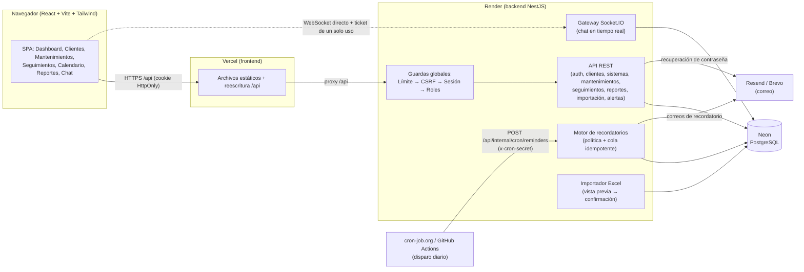
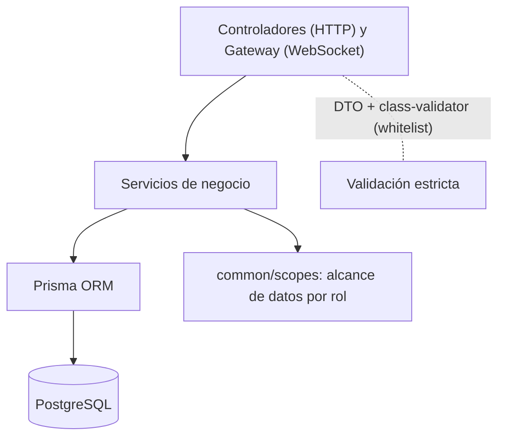

# Arquitectura

## Diagrama general

> Nota: Vercel no reenvía WebSockets, por eso el chat se conecta directo a la API (el navegador pide antes un ticket de 60 s por HTTP con su sesión). El resto del tráfico pasa por el proxy `/api`, así la cookie de sesión sigue siendo del mismo sitio.

## Capas del backend (NestJS)

## Monorepo (npm workspaces)
| Carpeta | Contenido |
|---|---|
| `apps/api` | NestJS 11 + Prisma 6. Módulos: `auth`, `users`, `clients`, `installations`, `systems`, `catalogs`, `technicians`, `maintenance`, `follow-ups`, `reminders`, `email`, `chat`, `imports`, `reports`, `dashboard` (resumen y alertas), `audit`, `health`, `common`, `config`. |
| `apps/web` | React 19 + Vite + Tailwind 4 + TanStack Query + FullCalendar + socket.io-client. |
| `apps/e2e` | Playwright (Edge/Chromium) con entorno temporal propio. |
| `docs` | Documentación (este directorio). |

## Decisiones clave
- **Autorización en el backend**: guardas globales en orden *Throttler → CSRF → Sesión → Roles*; el alcance de datos del técnico vive en `common/scopes.ts` y lo comparten pantallas, reportes, exportaciones, alertas y salas de chat.
- **Sesión por cookie** (no JWT en el navegador): token aleatorio, guardado como SHA-256, revocable, `HttpOnly`/`SameSite=Lax`/`__Host-`.
- **Chat con Socket.IO**: ticket de un solo uso (no depende de cookies entre dominios), salas validadas en cada mensaje, mensajes persistidos y con límite de longitud y de velocidad.
- **Alertas internas independientes del correo**: la campana muestra lo vencido y lo próximo aunque el cliente no tenga correo o el envío esté en modo prueba.
- **Recuperación de contraseña**: token aleatorio de un solo uso (solo se guarda su hash), vence en 60 min y cierra todas las sesiones.
- **Fechas de negocio** en `America/Guayaquil`; las fechas «solo día» se manejan sin hora para evitar corrimientos.
- **Recordatorios**: política pura (primer aviso 1 mes antes, luego semanal, también vencido, se detiene al finalizar/cancelar) + tabla `Notification` con `dedupeKey` único (idempotencia) + reclamo `FOR UPDATE SKIP LOCKED` + reintentos con espera + re-validación justo antes de enviar. Detalle en [EMAIL_REMINDERS.md](EMAIL_REMINDERS.md).
- **Importación de Excel**: vista previa obligatoria, planificador puro, ejecución todo-o-nada que solo agrega, trazabilidad por lote. Detalle en [EXCEL_IMPORT.md](EXCEL_IMPORT.md).
- **Reportes**: 13 reportes con filtros, permisos por rol y exportación XLSX/CSV/PDF. Detalle en [REPORTES.md](REPORTES.md).
- **Sin dependencia del equipo del usuario**: todo corre en servicios en la nube; el PostgreSQL embebido es solo de desarrollo y pruebas.
- **Correo en modo prueba por defecto**: nada sale a destinatarios reales sin configuración explícita (`EMAIL_MODE=live`).

## Del monolito modular a microservicios (segundo bimestre)
Hoy el backend es un **monolito modular**: cada módulo (`auth`, `clients`, `maintenance`, `follow-ups`, `reminders`, `chat`…) tiene su controlador, servicio y DTO, y solo comparte la base de datos y los helpers de `common`. Esa separación es el punto de partida natural para extraer servicios: `reminders` (cola + correo) y `chat` (WebSocket) son los candidatos más claros porque ya tienen ciclos de vida y escalado distintos.

## Pruebas
188 de API (unitarias, integración, seguridad, chat y recuperación) + 16 E2E en navegador. Ver [SECURITY.md](SECURITY.md) y el README.
