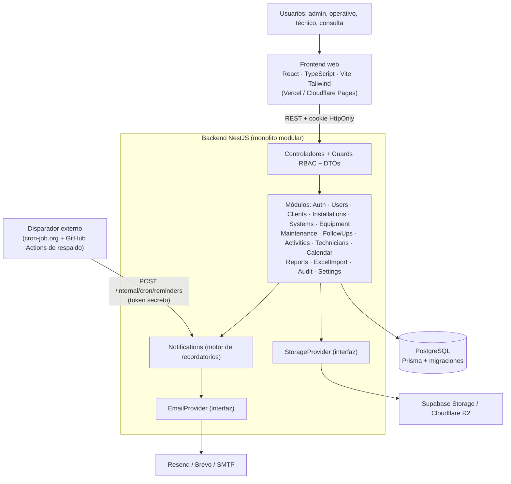
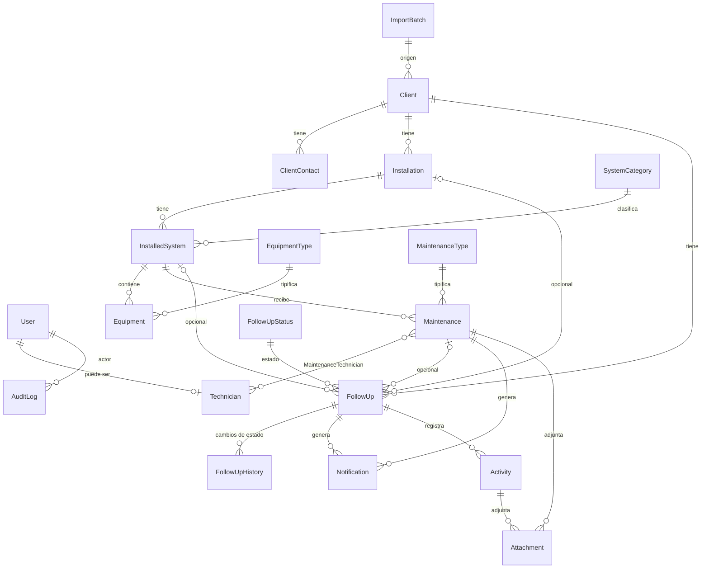

# FASE 0 — Arquitectura, modelo y plan (IGNIS Maintenance Manager)

Estado: **propuesta, pendiente de aprobación**. No se ha escrito código de la aplicación.
Análisis del Excel: ver [ANALISIS_PROCESO_ACTUAL.md](ANALISIS_PROCESO_ACTUAL.md).

## 1. Propuesta de solución

Monolito modular (un backend, un frontend, una base de datos). Para ~100 clientes y ~140 sistemas, los microservicios añadirían costo y complejidad sin beneficio.

## 2. Arquitectura



Capas dentro de cada módulo: *presentation* (controller/DTO) → *application* (service/casos de uso) → *domain* (reglas puras: fechas, estados, política de recordatorios) → *infrastructure* (Prisma, proveedores). Las reglas críticas del dominio son funciones puras, fáciles de probar.

## 3. Tecnologías, justificación y alternativas gratuitas

Verificado hoy (2026-11-24) por búsqueda web; **los planes cambian, se reconfirmará en la Fase 10**.

| Componente | Elección | Por qué | Alternativa |
|---|---|---|---|
| Frontend | React+TS+Vite+Tailwind, TanStack Query, React Router, FullCalendar, Recharts | Estándar, accesible, sin lock‑in | — |
| Backend | NestJS + Prisma | Modular, DTOs/validación/Swagger incluidos | Fastify |
| BD | **PostgreSQL en Neon** | Free: 100 CU‑h/mes y 1 GB por proyecto; suspende tras 5 min sin uso (despierta en segundos). No se pausa por semanas. | Supabase (500 MB; **se pausa tras ~1 semana sin actividad**) |
| Auth | Propia: argon2/bcrypt + sesión en cookie HttpOnly/Secure/SameSite | Sin dependencia de proveedor; permisos reales en backend | Supabase Auth |
| Correo | **Brevo** (300/día, pie de Brevo en el correo) o **Resend** (100/día, 3 000/mes; requiere dominio propio) | Volumen de IGNIS es bajo (decenas/día); ambos sobran | SMTP del dominio |
| Hosting backend | **Render web service gratis** (spin‑down a los 15 min; ~1 min de arranque; 750 h/mes) | Gratis y sencillo | Fly.io/Railway (verificar), VPS barato (~US$5/mes) |
| **Scheduler** | **Cron externo (cron‑job.org) que llama a un endpoint protegido**, + workflow de GitHub Actions como respaldo | Ver §6: el cron interno no funciona si el servicio duerme; GitHub Actions por sí solo puede retrasarse horas | Render Cron (verificar si es gratis) |
| Archivos | Supabase Storage o Cloudflare R2 (verificar cuota) detrás de `StorageProvider` | No acoplar a un proveedor | Disco del VPS |
| Excel | ExcelJS | Pedido | — |
| Pruebas | Jest (unit/integración), Playwright (E2E) | Pedido | — |

**Riesgo principal de costo/fiabilidad**: Render gratis duerme el servicio. Es aceptable *solo* porque el disparador externo lo despierta cada día y la lógica de recordatorios es **idempotente y recupera atrasos** (calcula "qué debió enviarse hasta ahora", no "qué toca exactamente hoy"). Si se quiere cero latencia/cero riesgo: Render Starter (~US$7/mes, no duerme).

## 4. Modelo de datos (ER)

Se descartan tablas innecesarias: `Role/UserRole` → enum de rol en `User` (4 roles fijos); `NotificationRecipient` → destinatarios en `ReminderRule`; `EmailLog` se fusiona con `Notification`.



Entidades (campos clave):

- **User**: email único, passwordHash, role (ADMIN | OPERATIVO | TECNICO | CONSULTA), active, lastLogin.
- **Technician**: nombre, email, teléfono, cargo, especialidad, estado, fechaIngreso, `initials` (para mapear el Excel), userId opcional. *Sin cédula por defecto.*
- **Client**: nombreComercial, razónSocial, RUC, ciudad, provincia, teléfono, email, status, `deletedAt` (soft delete), `normalizedName` (índice para duplicados).
- **ClientContact**: nombre, cargo, teléfono, email, `receivesNotifications` (false por defecto).
- **Installation**: clientId, nombre/tipo (matriz, sucursal…), dirección, ciudad, provincia, contacto, status.
- **SystemCategory** (catálogo administrable: las 7 categorías iniciales) y **EquipmentType** (catálogo de dispositivos).
- **InstalledSystem**: installationId, categoryId, marca, modelo, serie, fechaInstalación, ubicación, estadoOperativo, `relation` (INSTALADO/MTTO), responsableId, `lastMaintenanceDate`, `nextMaintenanceDate`, `extra` (JSONB para datos técnicos adicionales).
- **Equipment**: systemId, typeId, cantidad, estado, observaciones.
- **Maintenance**: systemId, typeId (catálogo configurable), scheduledDate, executedDate, nextMaintenanceDate (la fija el usuario), status, descripción, observaciones, recomendaciones, materiales, resultado; **MaintenanceTechnician** (N:M).
- **FollowUp**: clientId, installationId?, systemId?, maintenanceId?, título, descripción, tipo, statusId, prioridad, responsableId, startDate, **targetDate**, completedAt, completedById, nextAction, `remindersEnabled`.
- **FollowUpStatus** (catálogo, con flag `isTerminal`): PENDIENTE, EN PROCESO, ESPERANDO CLIENTE, ESPERANDO REPUESTOS, PROGRAMADO, FINALIZADO, CANCELADO.
- **FollowUpHistory**: estado anterior/nuevo, usuario, fecha/hora, observación.
- **Activity**: cliente, instalación, seguimiento?, mantenimiento?, usuario, tipo, descripción, fecha.
- **Attachment**: entidad polimórfica (tipo+id), storageKey, nombre, MIME, tamaño, hash.
- **Notification**: followUpId/maintenanceId, recipientEmail, tipo (FIRST/WEEKLY/OVERDUE), `dedupeKey` **único**, `scheduledFor`, status (PENDING/SENDING/SENT/FAILED/CANCELLED), attempt, nextAttemptAt, error, providerMessageId, sentAt.
- **ReminderRule/Settings** (clave-valor + destinatarios): leadDays=30, repeatDays=7, maxAttempts, correos internos, remitente.
- **AuditLog**: actor, acción, entidad, antes/después (sin secretos), IP, fecha.
- **ImportBatch**: archivo, hash, usuario, estado, resumen, reporte de errores.

Índices clave: `Client.normalizedName`, `FollowUp(statusId, targetDate)`, `Maintenance(status, scheduledDate)`, `InstalledSystem.nextMaintenanceDate`, `Notification(status, nextAttemptAt)`, `Notification.dedupeKey` UNIQUE.

## 5. Estructura del proyecto

```
Ignis -System/
├─ apps/
│  ├─ api/                 # NestJS
│  │  ├─ prisma/ (schema, migrations, seed)
│  │  └─ src/ modules/{auth,users,clients,installations,systems,equipment,
│  │      maintenance,follow-ups,activities,technicians,calendar,notifications,
│  │      email,reports,excel-import,audit,settings,health}
│  │      common/ (guards, filters, interceptors, config)
│  └─ web/                 # React + Vite
│     └─ src/{app,components,features/<módulo>,lib,routes}
├─ packages/shared/        # tipos/enums compartidos
├─ docs/                   # ARCHITECTURE, DATABASE, DEPLOYMENT, EMAIL_REMINDERS, EXCEL_IMPORT, SECURITY, USER_GUIDE
├─ .github/workflows/      # CI + cron de respaldo
├─ .env.example
└─ README.md
```

## 6. Estrategia de recordatorios por correo

**Regla** (con el ejemplo del 24 de diciembre): primer aviso a T‑30 días, luego cada 7 días (T‑23, T‑16, T‑9, T‑2), y tras vencer, cada 7 días con texto "VENCIDO", hasta FINALIZADO/CANCELADO.

- **Mes anterior**: "un mes antes" = `targetDate − 1 mes calendario`, recortado al último día del mes si no existe (31 mar → 28/29 feb). *Nota:* tu ejemplo 24 dic → 24 nov coincide con "1 mes calendario" (30 días daría 24 nov también). Propongo **1 mes calendario** y, de ahí, +7 días. Configurable.
- **Aviso**: los avisos semanales se cuentan desde el primero (24 nov, 1 dic, 8 dic, 15 dic, 22 dic, 29 dic…), no desde la fecha objetivo.
- **Zona horaria**: todo se evalúa en `America/Guayaquil` (UTC‑5, sin horario de verano). Envío a las 08:00 locales.
- **Motor** (job idempotente que corre cada hora/día):
  1. Selecciona seguimientos/mantenimientos activos, no terminales, con `remindersEnabled`.
  2. Calcula las **ocurrencias que ya debieron enviarse** (`dedupeKey = followUpId:destinatario:fechaOcurrencia`).
  3. `INSERT … ON CONFLICT DO NOTHING` en `Notification` → la restricción única evita duplicados aunque haya ejecuciones simultáneas o reinicios.
  4. Reclama filas `PENDING` con `SELECT … FOR UPDATE SKIP LOCKED` (marca `SENDING`), envía y guarda resultado.
  5. Falla → `FAILED` con `nextAttemptAt` por backoff (5 min, 30 min, 2 h, 12 h; máx. configurable). Un fallo no detiene el resto del lote.
  6. Si el servicio estuvo dormido varios días, **solo se envía el último aviso pendiente**, no una ráfaga.
- **Finalizar**: en la misma transacción que el cambio de estado: se registra `completedAt/By`, se pasan a `CANCELLED` todas las `Notification` PENDING/FAILED y el motor ignora estados terminales. Efecto inmediato, sin esperar al cron.
- **Destinatarios**: responsable + correos internos configurados + contactos del cliente **solo si** `receivesNotifications` está activo. Ningún correo hardcodeado.
- **Modo seguro**: en desarrollo, proveedor `console/mailpit`; en producción, `EMAIL_MODE=live` explícito. Una lista blanca evita enviar a terceros por error.
- **Disparador**: `POST /internal/cron/reminders` con token secreto, invocado por cron‑job.org (diario/cada hora). GitHub Actions de respaldo. El estado del scheduler (última ejecución) aparece en `/health/ready`.

## 7. Estrategia de importación del Excel

Flujo: subir XLSX → elegir hoja → ver datos → mapear columnas (plantilla sugerida para la hoja "CARTERA DE CLIENTES") → validar → detectar duplicados → vista previa con errores/advertencias → **confirmación explícita** → importar en transacción → reporte descargable.

Reglas: nunca borra; nombres normalizados; fechas inválidas → error; fechas pasadas → opción "importar como histórico (sin recordatorios)"; correos validados; duplicados → "omitir / fusionar / crear nuevo" por fila; `ImportBatch` con hash del archivo para que re-importar no duplique. Tamaño máx. 10 MB, solo `.xlsx`, validación de MIME y firma de archivo. Plantilla oficial descargable.

## 8. Estrategia de seguridad

Argon2id; sesión en cookie HttpOnly+Secure+SameSite=Lax con CSRF token en mutaciones; RBAC por guards en el backend (el frontend solo oculta); `class-validator` en todos los DTOs; Prisma parametrizado (sin SQL concatenado); Helmet, CORS con lista de orígenes, rate limiting (login estricto); subida de archivos con lista de MIME, límite de tamaño y nombres aleatorios; endpoint de cron con token comparado en tiempo constante; logs sin contraseñas/tokens; secretos solo en variables de entorno; auditoría de acciones críticas; **cédulas no se almacenan por defecto**.

## 9. Plan de fases

| Fase | Contenido | Criterio de salida |
|---|---|---|
| 1 | Monorepo, config, Prisma+migraciones, auth, usuarios/roles, layout, dashboard base | Login real + RBAC probado |
| 2 | Clientes, contactos, instalaciones | CRUD + búsqueda/paginación + soft delete |
| 3 | Catálogos, sistemas, equipos | Las 7 categorías en BD, administrables |
| 4 | Mantenimientos, técnicos, calendario | Programar→ejecutar→próximo mtto |
| 5 | Seguimientos, historial, actividades | Finalizar con trazabilidad |
| 6 | Correos, scheduler, idempotencia, reintentos | Tests: sin duplicados, se detiene al finalizar |
| 7 | Importación Excel | Importación del Excel real en entorno de prueba |
| 8 | Reportes y exportaciones, dashboard completo | Excel/CSV/PDF |
| 9 | Pruebas, seguridad, permisos | Suite verde |
| 10 | Despliegue, CI/CD, documentación | Sistema en producción gratuita |

Se ejecutan pruebas al final de cada fase y no se avanza con errores críticos.

## 10. Riesgos técnicos

1. **Render se duerme** → mitigado con disparador externo + lógica de recuperación; puede añadir ~1 min de latencia al primer acceso.
2. **Retrasos de GitHub Actions** (reportados de horas) → solo respaldo, no principal.
3. **Calidad de datos del Excel** (§4 del análisis) → importación asistida con validación humana.
4. **Cuotas gratuitas** (Neon 1 GB, correo 100–300/día) → suficientes hoy; hay monitoreo.
5. **Dominio de correo**: Resend exige dominio verificado (SPF/DKIM) para enviar a terceros; sin dominio, la entregabilidad es limitada.
6. **Datos personales** (cédulas) y **sin correos de clientes** en el origen.
7. **Fechas con precisión mensual** en el Excel vs. fecha objetivo diaria en el sistema.
8. Los planes gratuitos pueden cambiar o retirar el servicio.

## 11. Costos potenciales

| Servicio | Gratis | Si se supera |
|---|---|---|
| Frontend (Vercel/Cloudflare Pages) | US$0 | Planes pagos desde ~US$20/mes |
| Backend Render | US$0 (duerme) | Starter ~US$7/mes (no duerme) |
| BD Neon | US$0 (1 GB, 100 CU‑h) | Pago por uso (~US$0.35/GB‑mes almacenamiento) |
| Correo Brevo/Resend | US$0 (300/día · 100/día) | Resend desde ~US$20/mes; Brevo desde ~US$9/mes |
| Cron externo | US$0 | — |
| Dominio | ~US$10–15/año (opcional pero recomendado) | — |

Cifras de planes pagos aproximadas y por reconfirmar en la Fase 10.

## 12. Recomendaciones para producción

Empezar con el stack gratuito; si los recordatorios son críticos, pagar **solo Render Starter (~US$7/mes)**; dominio propio con SPF/DKIM; respaldos periódicos de la BD (`pg_dump` programado); monitor externo de `/health/ready`; revisión de usuarios y permisos antes del arranque; piloto con datos importados y `EMAIL_MODE` en prueba antes de activar envíos reales.

## 13. Decisiones que necesito de ti para iniciar la Fase 1

1. ¿Apruebas el **monolito modular NestJS + Prisma + Neon + Render + Brevo/Resend**?
2. ¿Tienen **dominio propio** (para el remitente de correo y el enlace del sistema)?
3. Confirmar **iniciales de técnicos** (FR, RC, FA, RN) y si se almacenan **cédulas**.
4. Política para los **109 mantenimientos vencidos** del Excel: ¿importar como histórico sin recordatorios?
5. ¿Se incluye en el futuro el módulo de **viáticos** (hoja existente en el Excel)?
6. Enlace "mes antes": ¿**1 mes calendario** (propuesto) o 30 días?

Fuentes consultadas (límites de planes gratuitos, a reconfirmar): [Render free](https://render.com/docs/free), [Neon límites](https://neon.com/docs/introduction/limits), [Resend quotas](https://resend.com/docs/knowledge-base/account-quotas-and-limits), [Brevo free plan](https://help.brevo.com/hc/en-us/articles/208580669), [Supabase pausa](https://supabase.com/docs/guides/platform/free-project-pausing).
